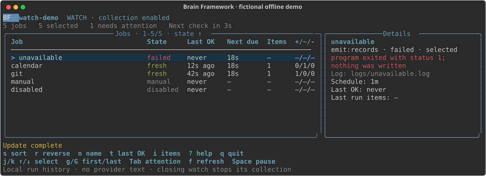

<p align="center">
  
</p>

Brain Framework (`bf`) turns a folder of plain Markdown notes and collected JSON records into a local, verifiable knowledge graph for you and any coding agent.

- **Plain files you own.** Notes (`projects/`, `concepts/`, `actions/`), records (`memories/`), and config (`bf.yaml`, `evals/`), accessible through `bf`, local stdio [MCP](https://fmind.github.io/brain-framework/docs/retrieval/), [Agent Skills](https://agentskills.io/specification), and `AGENTS.md`.
- **Gather, connect, act offline.** Scheduled or streaming `jobs:` collect or ingest records (`bf collect`, `bf ingest`), declarative `map:` normalizes fields, BM25 + graph links trace every claim, and prompt jobs wake harnesses only when events or gates fire.
- **No lock-in or built-in LLM.** BF runs zero models, accounts, or telemetry; search and read stay 100% offline.

[](https://github.com/fmind/brain-framework/actions/workflows/ci.yml) [](https://pypi.org/project/brain-framework/) [](https://pypi.org/project/brain-framework/) [](https://github.com/fmind/brain-framework/blob/main/LICENSE)

## Try it

Requires Linux or macOS and [uv](https://docs.astral.sh/uv/getting-started/installation/) — no model or cloud account needed:

```bash
uv tool install --python 3.14 brain-framework
bf init ~/brain
cd ~/brain
bf guide                      # Offline documentation inside the CLI
bf validate
bf eval
```

Explore the [four-tool walkthrough](https://github.com/fmind/brain-framework/blob/main/examples/context-hub/README.md) (Workspace, Jira, GitHub, and Google Cloud fixtures) or read [Getting started](https://fmind.github.io/brain-framework/docs/getting-started/).

## How it works

<a href="https://raw.githubusercontent.com/fmind/brain-framework/main/docs/assets/brain-loop.svg">
  
</a>

- **Notes & graph ([Authoring](https://fmind.github.io/brain-framework/docs/authoring/)):** OKF Markdown notes with explicit `relations:` and `attributes:`, plus tracked `ACTION.md` workflows (`bf action new|status`).
- **Offline retrieval ([Retrieval](https://fmind.github.io/brain-framework/docs/retrieval/)):** Disposable `.bf/cache.sqlite3` powers `bf search`, `bf read`, review pages, `bf export`, `bf eval`, and `bf mcp`.
- **Agents & skills ([Getting started](https://fmind.github.io/brain-framework/docs/getting-started/)):** Install the `/bf` skill (`bf skill install --global`) and register brains (`bf register . --default`); optional host [hooks](https://github.com/fmind/brain-framework/tree/main/examples/hooks) surface brain state automatically.
- **Sensors, ingest & routines ([Jobs](https://fmind.github.io/brain-framework/docs/jobs/)):** Copy stdlib scripts from [sensors](https://github.com/fmind/brain-framework/tree/main/examples/sensors) and [routines](https://github.com/fmind/brain-framework/tree/main/examples/routines), pipe external JSON via `bf ingest`, and normalize fields with declarative `map:`.
- **Prompts, channels & watch ([Assist](https://fmind.github.io/brain-framework/docs/assist/)):** Event-driven prompt jobs (`record.*`, `note.changed`, `message.received`, `job.failed`), DM allowlists (`{{lines:...}}`), durable channel queues, failure incidents, and `bf watch` ([demo](https://github.com/fmind/brain-framework/tree/main/examples/watch)).

<a href="https://raw.githubusercontent.com/fmind/brain-framework/main/docs/assets/watch.svg">
  
</a>

## Good to know

1. **Local-first and private.** Retrieval runs offline; `.bf/` locks, caches, and durable queues (`runtime.sqlite3`) never touch the network ([Operations](https://fmind.github.io/brain-framework/docs/operations/)).
2. **Harnesses reason; BF verifies.** BF invokes your configured CLI harness only on explicit runs, schedules, or event/gate matches, and validates every note, record, and `bf.yaml` (`version: 11`) ([Reference](https://fmind.github.io/brain-framework/docs/reference/)).
3. **Git-native collaboration.** Track notes, `bf.yaml`, `jobs/`, and `evals/` in Git while ignoring `memories/`, `actions/`, `logs/`, and `.bf/`.

[Documentation](https://fmind.github.io/brain-framework/) · [Reference](https://fmind.github.io/brain-framework/docs/reference/) · [Issues](https://github.com/fmind/brain-framework/issues) · [Contribute](https://github.com/fmind/brain-framework/blob/main/CONTRIBUTING.md) · [Governance](https://github.com/fmind/brain-framework/blob/main/GOVERNANCE.md) · [MIT License](https://github.com/fmind/brain-framework/blob/main/LICENSE) · [Third-party notices](https://github.com/fmind/brain-framework/blob/main/THIRD_PARTY_NOTICES.md)
