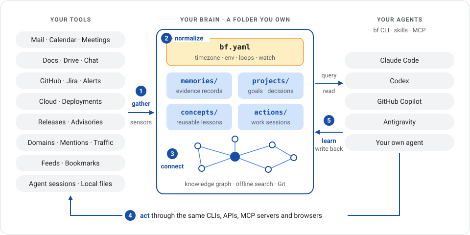

<p align="center">
  
</p>

<h1 align="center">Brain Framework</h1>

<p align="center">
  <strong>From scattered information to informed actions, using plain files you own forever.</strong>
</p>

<p align="center">
  <a href="https://github.com/fmind/brain-framework/actions/workflows/ci.yml"></a>
  <a href="https://pypi.org/project/brain-framework/"></a>
  <a href="https://pypi.org/project/brain-framework/"></a>
  <a href="https://github.com/fmind/brain-framework/blob/main/LICENSE"></a>
</p>

AI coding agents lose context between sessions, while proprietary memory platforms lock your knowledge inside opaque databases. **Brain Framework (`bf`)** turns a plain Git folder of Markdown notes, schema-validated JSONL records, and shell or Python loops into a fast, offline knowledge brain for humans and AI coding agents.

- **Plain files, zero lock-in**: YAML for config, Markdown for humans, canonical JSONL for records. Inspect or query your data anytime with `git`, `rg`, `jq`, or DuckDB.
- **Instant offline BM25 search**: A strictly disposable SQLite FTS5 cache ranks authored notes ahead of raw memories, resolves aliases and backlinks, and never mutates disk on read-only commands.
- **Least-privilege automation loops**: Run deterministic collectors (`sensors/`), maintenance jobs (`routines/`), coding agents (`agents/`), and stream daemons (`when: daemon`) with per-loop secret allowlists (`env_from:`) and headless `bf watch`.
- **Lean, model-agnostic core**: Three runtime dependencies (`jsonschema`, `markdown-it-py`, `pyyaml`) on Python 3.12+, zero built-in LLMs, and zero global config.

## Quick start

Requires Linux or macOS and [uv](https://docs.astral.sh/uv/getting-started/installation/) (Python 3.12+). No model API key, database server, or cloud account is required:

```bash
uv tool install brain-framework
bf init ~/brain
cd ~/brain
bf check --format text
bf status --format text
bf query "welcome" --format text
```

Output on a fresh brain:

```text
Check: brain  [OK]
  notes=1  memories=0  errors=0  warnings=0

Brain: brain  [HEALTHY]
  notes=1  memories=0  loops=0  events=1

Query (fts5): 1 result(s) for 'welcome'

  concepts/welcome.md#welcome  Welcome
```

If `BF_BRAIN` is already exported in your shell, unset it or pass `--brain ~/brain`.

Next, follow [Getting started](https://fmind.github.io/brain-framework/getting-started/) to ingest records and write linked decisions, or run the [four-tool walkthrough](https://github.com/fmind/brain-framework/blob/main/examples/context-hub/README.md) with synthetic Workspace, Jira, GitHub, and Google Cloud fixtures.

## How it works

<a href="https://raw.githubusercontent.com/fmind/brain-framework/main/docs/assets/brain-loop.svg">
  
</a>

A brain is one portable directory organized around a **3x3 layout** (three note folders, three loop folders, three JSONL record streams):

```text
my-brain/
├── bf.yaml         # Config: notes, brains, search.exclude, concurrency pools, loops
├── concepts/       # Durable knowledge (<slug>.md or <slug>/index.md bundles)
├── projects/       # Ongoing initiatives and decisions
├── actions/        # Scoped requests, deliverables, and attachments
├── sensors/        # Deterministic collectors (stdout JSONL -> memories/)
├── routines/       # Maintenance scripts and continuous daemons (when: daemon)
├── agents/         # Coding-harness or LLM tasks
├── schemas/        # Optional domain JSON Schemas (core record schema always enforced)
├── evals/          # User-owned Python/pytest contract checks
├── memories/       # Canonical JSONL (_notes.jsonl + <source>.jsonl; gitignored)
├── logs/           # Private 0700 structured JSONL loop logs (gitignored)
└── .bf/            # Private 0700 runtime: disposable cache/index.sqlite3, state/, locks/
```

- [**Authoring**](https://fmind.github.io/brain-framework/authoring/): Write CommonMark Markdown with YAML frontmatter, `#id` heading anchors, checklist tasks, typed links (`{rel=cites}`), universal refs (`source:id`, `bf://`), and optional `schemas/<source>.json` validation.
- [**Retrieval**](https://fmind.github.io/brain-framework/retrieval/): Search ranked BM25 hits and `--links-to` backlinks with `bf query`, resolve notes, `#anchor` sections, or aliases with `bf read`, track freshness with `bf review`, and run `rg`, `jq`, or DuckDB directly on `memories/*.jsonl`.
- [**Operations**](https://fmind.github.io/brain-framework/operations/): Declare explicit `loops:` with named `concurrency:` pools, per-loop `env_from:` secrets, trailing-edge `debounce:`, delayed `bf emit --in|--at` wakeups, live `bf pause`/`bf resume`, and headless `bf watch` supervision.
- [**Reference**](https://fmind.github.io/brain-framework/reference/): Full CLI contract (strict read-only vs write commands), exit codes, `BF_*` env vars, `{{...}}` placeholders, `bf.yaml` config, and published Draft 2020-12 JSON Schemas (`bf schema`).

## Works with your AI coding harness

`bf` pairs with Claude Code, Codex, Antigravity, Gemini CLI, OpenCode, or any terminal agent without an MCP server:

- **Inside a brain**: Agents read the repo's `AGENTS.md`, orient with `bf status` and `bf review`, edit Markdown notes directly, and verify with `bf build && bf check` plus `evals/`.
- **From any repository**: Set `export BF_BRAIN=~/brain` and install the optional [`/bf` skill](https://github.com/fmind/brain-framework/blob/main/skills/bf/SKILL.md) (`npx skills add fmind/brain-framework --skill bf`) so your harness queries and updates your brain on demand.
- **Always-on supervision**: Run `bf watch` headlessly under `systemd --user` or `launchd` and monitor live in any terminal with `watch -n 2 bf status --format text`.

## Design principles

1. **Strict read/write boundary**: `bf status`, `bf review`, `bf read`, `bf query`, `bf events`, `bf check`, and `bf schema` never touch disk. Cache readers open `.bf/cache/index.sqlite3` in strict read-only mode (`mode=ro`) with automatic JSONL fallback.
2. **Private and confined by default**: Every path opens via `O_NOFOLLOW` directory descriptors, `.bf/` and `logs/` enforce `0700`/`0600` owner-only permissions, secrets stay scoped to each loop's `env_from:`, and logs redact credentials automatically.
3. **Git-native collaboration**: Track notes, config, schemas, loops, and evals in Git while keeping generated `memories/`, private `logs/`, `.env`, and `.bf/` local.

---

[Documentation](https://fmind.github.io/brain-framework/) · [Examples](https://github.com/fmind/brain-framework/blob/main/examples/README.md) · [Issues](https://github.com/fmind/brain-framework/issues) · [Contributing](https://github.com/fmind/brain-framework/blob/main/CONTRIBUTING.md) · [Governance](https://github.com/fmind/brain-framework/blob/main/GOVERNANCE.md) · [Security](https://github.com/fmind/brain-framework/blob/main/SECURITY.md) · [Third-party notices](https://github.com/fmind/brain-framework/blob/main/THIRD_PARTY_NOTICES.md)
