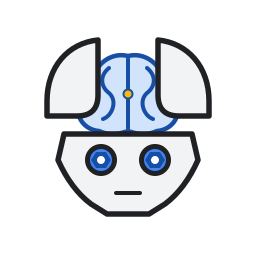
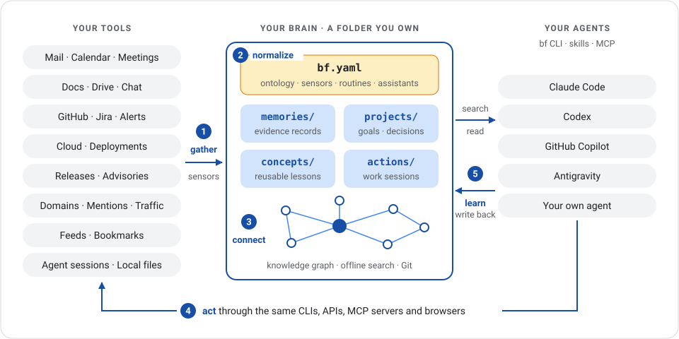
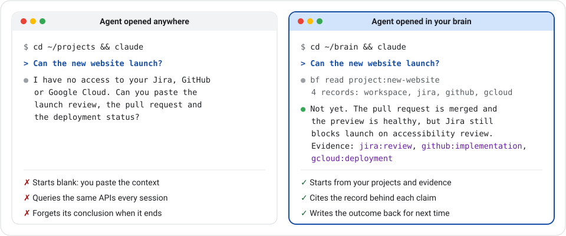
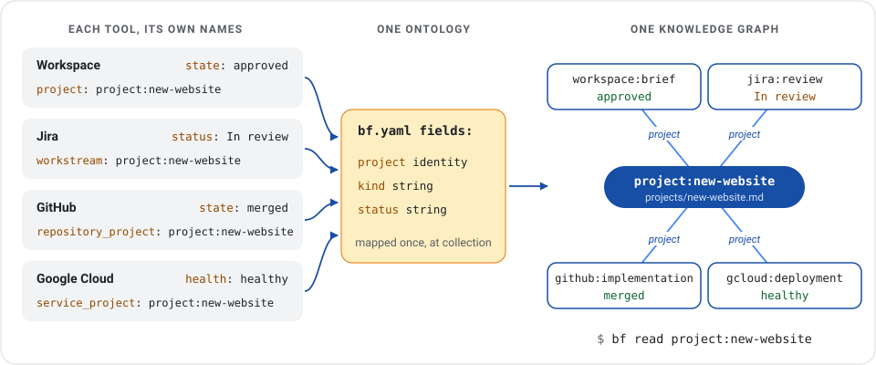
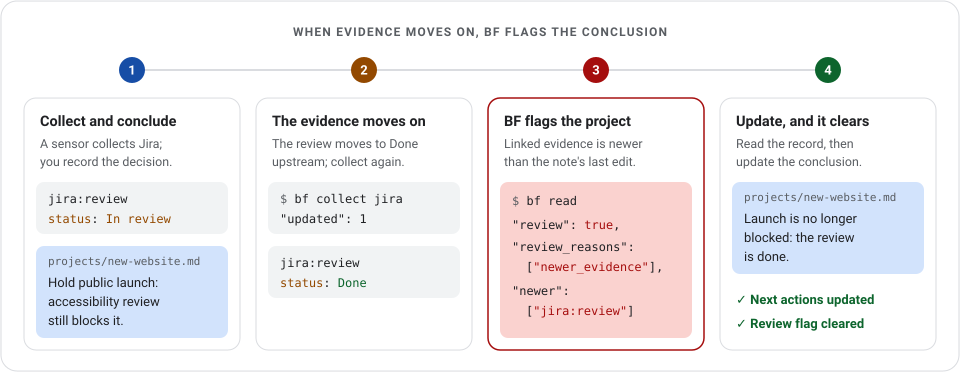
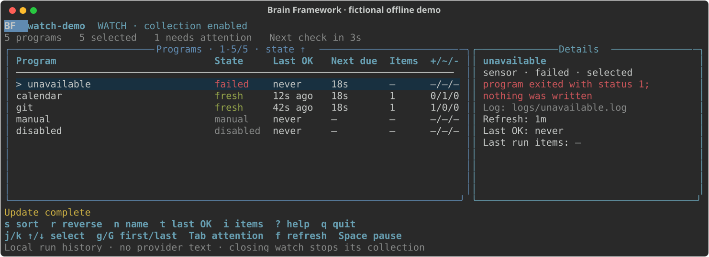

<p align="center">
  
</p>

# Brain Framework 🧠

**🧠 Brain Framework: from information to informed actions.**

A second brain for you, your team and your AI agents, on your own computer. Gather what matters from every tool you work with, connect it into one knowledge graph and open your agent there, so it acts with everything you know instead of starting from scratch.

[](https://github.com/fmind/brain-framework/actions/workflows/ci.yml) [](https://pypi.org/project/brain-framework/) [](https://pypi.org/project/brain-framework/) [](https://github.com/fmind/brain-framework/blob/main/LICENSE)

[Try it](https://github.com/fmind/brain-framework#try-it) · [How it works](https://github.com/fmind/brain-framework#how-it-works) · [Agents](https://github.com/fmind/brain-framework#open-your-agent-in-your-brain) · [Your tools](https://github.com/fmind/brain-framework#bring-your-tools) · [Good to know](https://github.com/fmind/brain-framework#good-to-know) · [Documentation](https://fmind.github.io/brain-framework/)

<a href="https://raw.githubusercontent.com/fmind/brain-framework/main/docs/assets/brain-loop.svg">
  
</a>

## Stop starting from scratch

Open an agent anywhere on your computer and it knows nothing: not your projects, not last week's decisions, not what changed overnight. It asks you to paste context, queries the same APIs again and forgets its conclusion when the session ends.

Brain Framework (BF) changes the starting point. Create a brain, a plain folder, and let small programs called sensors fill it with evidence from your tools. Open your agent there: it searches your projects, decisions and collected records, cites where each fact comes from, acts through the tools you already use and writes the outcome back for the next session.

<a href="https://raw.githubusercontent.com/fmind/brain-framework/main/docs/assets/blank-vs-brain.svg">
  
</a>

Once you write or adapt a sensor for each source, questions that took a tour of your tools become one prompt:

| Ask your agent                        | Gathered from                                                                                                 |
| ------------------------------------- | ------------------------------------------------------------------------------------------------------------- |
| “Can the new website launch?”         | The brief in Google Drive, the review in Jira, the pull request in GitHub and the deployment in Google Cloud. |
| “Prepare my two o'clock meeting.”     | The Calendar event, the last meeting notes, the attendees' recent mail and chat threads.                      |
| “Where did we leave the migration?”   | The last action's next step, the spec and the latest commits.                                                 |
| “What changed in my stack this week?” | Release notes, security advisories, Dependabot alerts and model deprecation pages.                            |

## Try it

You need Linux or macOS and [uv](https://docs.astral.sh/uv/getting-started/installation/). No model or provider account is required.

```bash
uv tool install --python 3.14 brain-framework
bf init ~/brain
cd ~/brain
```

Save a decision as `projects/new-website.md`:

```markdown
---
type: project
status: draft
updated: 2026-11-01
summary: Launch a product website that helps visitors understand the product.
---

# New website

## Decision

Start with a single product page because visitors need a clear explanation before signing up.

## Next actions

- [ ] Draft the product page.
```

Find its reason, then read the exact section:

```bash
bf search "visitors clear explanation"
bf read projects/new-website.md#decision
```

Search prints compact JSON on one line; selected fields:

```json
{
  "items": [
    {
      "ref": "projects/new-website.md#decision",
      "title": "New website — Decision",
      "excerpt": "Start with a single product page because visitors need a clear explanation before signing up."
    }
  ]
}
```

[Getting started](https://fmind.github.io/brain-framework/docs/getting-started/) continues with validation and a first collected source. The [four-tool walkthrough](https://fmind.github.io/brain-framework/docs/context-hub/) runs the whole loop on fictional Workspace, Jira, GitHub and Gcloud records.

## How it works

A brain is a detective's case file in plain files: evidence bags labeled with where and when each item was collected, case notes with the current theory and next step, and string from each conclusion to its evidence. Five steps run in a loop: **gather → normalize → organize and connect → act → learn.**

| Folder      | Holds                                                                       | Example                                                              |
| ----------- | --------------------------------------------------------------------------- | -------------------------------------------------------------------- |
| `memories/` | One JSON file per collected item: what a source said, its URL and its time. | The Jira launch review, as collected on Tuesday.                     |
| `sensors/`  | Programs you review that print JSON records from a tool.                    | A script that lists the Jira issues of your projects.                |
| `projects/` | One Markdown note per project: goal, current state, decisions and tasks.    | “Start with a single product page because visitors need…”            |
| `concepts/` | Knowledge you will reuse elsewhere, with its evidence and limits.           | “Explain the product before asking for signup.”                      |
| `actions/`  | One work session: objective, inputs, outputs, outcome and next step.        | `actions/2026-09-27_website-review/ACTION.md`, resumed the next day. |
| `routines/` | Deterministic programs you review, run on demand or on a schedule.          | A weekly review that lists projects to revisit.                      |

Notes are Markdown with YAML metadata, records are JSON, and `bf validate` checks both. The search cache in `.bf/` is disposable and rebuilds itself from the files. Assistants, channels and retrieval checks have their own folders: see the [directory reference](https://fmind.github.io/brain-framework/docs/brain/#directory-reference).

`bf.yaml` declares what the brain knows how to name, collect and check:

```yaml
# https://fmind.github.io/brain-framework/docs/configuration/
version: 8
name: brain
fields: # the ontology: shared fields and typed relations
  project: { type: identity, cardinality: one, relation: true, description: Project the source names. }
  kind: { type: string, cardinality: one, description: Common kind of item. }
  status: { type: string, cardinality: one, description: The item's state in its own tool. }
sensors: # what to collect, how often, mapped into the ontology
  jira:
    command: [sensors/jira.py]
    mode: snapshot
    refresh: 3600
    fields:
      project: { path: /attributes/workstream }
      kind: { value: issue }
      status: { path: /attributes/status }
routines: # deterministic reviews and checks
  weekly-review:
    command: [routines/weekly-review.py, "{{brain}}", "{{end}}"]
    refresh: 604800
    output: action
watch: # keep sources fresh and alert on failure
  interval: 300
  notifications: failure
```

BF runs each program without a shell, bounds its time and output, validates what it prints and keeps its stderr in `logs/`. A failed run preserves the evidence already saved. See [sensors](https://fmind.github.io/brain-framework/docs/sensors/), [routines](https://fmind.github.io/brain-framework/docs/routines/) and [assistants and channels](https://fmind.github.io/brain-framework/docs/prompts/).

### One vocabulary, set at collection

<a href="https://raw.githubusercontent.com/fmind/brain-framework/main/docs/assets/one-vocabulary.svg">
  
</a>

Each tool names things its own way. BF translates once, at the door: each sensor maps its provider's fields into the shared `fields:` of `bf.yaml`, and BF validates every value before saving the record. Because `project` is a relation, records from all four tools point to the same identity, `project:new-website`. People and repositories work the same way. Mappings are explicit: BF never decides that two similar names are the same subject. See [shared fields and sensor mappings](https://fmind.github.io/brain-framework/docs/schema/#shared-fields-and-sensor-mappings).

### A knowledge graph across sources

Grep finds words, not connections. BF indexes every explicit connection (Markdown links, declared identities and relation fields) into a knowledge graph, so one read assembles a subject across sources:

```bash
bf read project:new-website
```

The reply holds the project note and its backlinks, grouped by relation: the Jira review `In review`, the GitHub pull request `merged`, the Gcloud deployment `healthy` and the Workspace brief `approved`. Each claim keeps the note section or record that asserted it, so an answer can always cite its evidence. See [links and relations](https://fmind.github.io/brain-framework/docs/links/#name-a-relation).

### Act, then learn

<a href="https://raw.githubusercontent.com/fmind/brain-framework/main/docs/assets/evidence-review.svg">
  
</a>

People and agents do the work through the CLIs, APIs and MCP servers they already use. An action keeps each session's objective, inputs, outputs and next step, so the next session resumes instead of starting over. When a linked record changes after a project's last edit, `bf read` flags the project for review and names the record to read first, so a decision does not silently outlive its evidence. Try it in the [four-tool walkthrough](https://fmind.github.io/brain-framework/docs/context-hub/#follow-a-change).

## Open your agent in your brain

Use the brain with [Claude Code](https://code.claude.com/docs/en/overview), [Codex](https://openai.com/codex/), [GitHub Copilot](https://github.com/features/copilot) or any agent that can run a command. Start it in `~/brain` and ask:

> Use the bf CLI. Find why we chose a single product page. Read the source, cite its ref and tell me the project's next action.

It should cite `projects/new-website.md#decision` and name “Draft the product page.” For ongoing use, install the packaged skills into the folder your host discovers (`~/.agents/skills` below; Claude Code uses `~/.claude/skills`):

```bash
bf skills ~/.agents/skills
```

| Skill         | Teaches your agent to…                                                          |
| ------------- | ------------------------------------------------------------------------------- |
| `bf-use`      | Find evidence, cite it, and keep projects and concepts current.                 |
| `bf-action`   | Start, resume and hand off a tracked work session: `/bf-action website-review`. |
| `bf-setup`    | Install BF, create a brain, connect the agent and choose sources worth adding.  |
| `bf-maintain` | Run sensors, routines and assistants, check the brain and upgrade it safely.    |

Working in a code repository instead? The [session hook](https://github.com/fmind/brain-framework/tree/main/examples/hooks) prints the project that declares the repository and its next task. Hosts that prefer tools can call `search` and `read` through [MCP](https://fmind.github.io/brain-framework/docs/mcp/). See the [agent guide](https://fmind.github.io/brain-framework/docs/agents/).

## Bring your tools

A sensor is a small program that prints JSON: wrap a CLI such as `gh`, `gws` or `gcloud`, call an API, drive a browser, query a database or parse an export. Start with a reviewed sensor, copy it into your brain's `sensors/` and adapt it:

| Source                                    | Starting point                                                                                                                                                                                                                                                                                                                                                                           |
| ----------------------------------------- | ---------------------------------------------------------------------------------------------------------------------------------------------------------------------------------------------------------------------------------------------------------------------------------------------------------------------------------------------------------------------------------------- |
| Local files, highlights and Git           | [Document](https://github.com/fmind/brain-framework/blob/main/examples/sensors/local-documents.py), [highlight](https://github.com/fmind/brain-framework/blob/main/examples/sensors/highlights.py) and [Git history](https://github.com/fmind/brain-framework/blob/main/examples/sensors/git-history.py) sensors.                                                                        |
| Google Calendar, Gmail and Drive          | [Calendar](https://github.com/fmind/brain-framework/blob/main/examples/sensors/google-calendar.py), [Gmail headers](https://github.com/fmind/brain-framework/blob/main/examples/sensors/gmail-headers.py) and [Drive folder](https://github.com/fmind/brain-framework/blob/main/examples/sensors/google-drive-folders.py) sensors using [`gws`](https://github.com/googleworkspace/cli). |
| GitHub, Jira, Confluence and Google Cloud | The [GitHub history sensor](https://github.com/fmind/brain-framework/blob/main/examples/sensors/github-history.md), or your own using [`acli`](https://developer.atlassian.com/cloud/acli/), [`gcloud`](https://cloud.google.com/sdk/gcloud) or their APIs.                                                                                                                              |
| Anything you can script                   | An API, a database query, a browser session or an export: [any source you can script](https://fmind.github.io/brain-framework/docs/sensors/#any-source-you-can-script) becomes a sensor.                                                                                                                                                                                                 |

The author's own brain runs more than 80 sensors and holds about 50,000 records (counted on 2026-10-16): mail, calendar, documents, chat, commits and pull requests, past agent sessions, release notes and advisories, mentions and site traffic. These are personal sensors, not bundled connectors; the `bf-setup` skill helps your agent connect a new source.

After reviewing your sensors, run `bf watch` to keep them refreshed and see failures as they happen, in a terminal or as a [systemd or launchd service](https://fmind.github.io/brain-framework/docs/schedule/):

<a href="https://raw.githubusercontent.com/fmind/brain-framework/main/docs/assets/watch.svg">
  
</a>

The dashboard shows the [offline watch demo](https://github.com/fmind/brain-framework/tree/main/examples/watch), which needs no provider account.

## Good to know

1. **Your data stays on your computer.** A brain is a folder on your disk. BF has no account, server or telemetry, and search and read work offline. Sensors collect while your machine is on.
1. **Your agent does the reasoning.** BF never runs a model: it collects, validates, searches and connects, and its [assistants](https://fmind.github.io/brain-framework/docs/prompts/) launch your agent harness. What your agent reads reaches that harness's provider; see [privacy and security](https://fmind.github.io/brain-framework/docs/privacy/) for a fully local setup.
1. **Git gives history and sharing.** Notes and programs are plain files: commit them for history, rollback and review. By default, collected records stay out of Git. A team brain is a private repository with one clone per teammate, and a personal brain can include it in its searches. See [team setup](https://fmind.github.io/brain-framework/docs/team/).
1. **It takes some setup.** Each source needs its access, such as `gh auth login` or `gcloud` authentication, then a sensor you review. Sensors, routines and the ontology are files you can read, edit or ask your agent to adapt.
1. **It finds what was said and linked, not what was meant.** Search matches words and explicit identities, without embeddings, and incomplete results say so. Collect again when you need newer evidence. See [what BF does not do](https://fmind.github.io/brain-framework/docs/concepts/#what-bf-does-not-do).

[Browse the commands](https://fmind.github.io/brain-framework/docs/commands/) · [Report an issue](https://github.com/fmind/brain-framework/issues) · [Contribute](https://github.com/fmind/brain-framework/blob/main/CONTRIBUTING.md) · [MIT licensed](https://github.com/fmind/brain-framework/blob/main/LICENSE) · [Third-party notices](https://github.com/fmind/brain-framework/blob/main/THIRD_PARTY_NOTICES.md)
