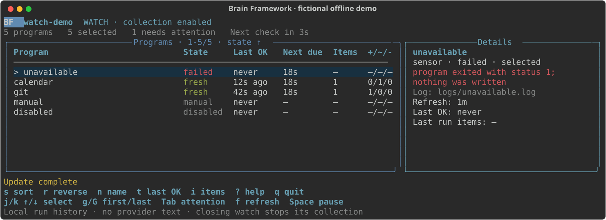

# Watch and schedule updates

Keep reviewed sensors and routines current with `enabled` and `refresh`; [assistants](prompts.md) declare separate inputs, outputs, schedules and triggers in `bf.yaml`; [timing and health](#timing-and-health) says when each one is due and how failures retry. Start inside your brain.

| You want to…                              | Use                                                                       |
| ----------------------------------------- | ------------------------------------------------------------------------- |
| Run due programs while a terminal is open | `bf watch`                                                                |
| Observe another collector                 | `bf status --watch`; it executes nothing.                                 |
| Run unattended on a running machine       | `bf schedule`, then install the generated systemd, launchd or cron files. |

BF installs no background service. First run your programs once by hand.

## Check before scheduling

```bash
bf update --dry-run    # list due work; run nothing
bf update              # run due sensors, then routines, then assistants
bf status --check
```

The dry run lists due programs with their windows, and names under `manual` the enabled programs with `refresh: 0` that updates skip. A healthy `bf status --check` exits 0. Set `enabled: false` to stop a program, or `refresh: 0` to keep it manual, as sensors and routines are by default. Keep CI for offline `bf validate` and `bf eval`; for a shared source, designate one [collecting laptop](team.md#collect-on-a-laptop).

## Watch collection

```bash
bf watch
```

Watch runs due sensors and routines at once, then checks again 60 seconds after each completed cycle; `--interval SECONDS` changes that. The assistant dispatcher supervises persistent streams, due batch reads, named schedules, queued events and deliveries beside collection; the dashboard marks assistants with `@`. A long proactive review leaves separate capacity for incoming messages. It can contact providers. Closing watch stops all owned process groups. Assistant work that cannot start, such as for a missing prompt or a full queue, never stops watch: the message line says why and watch retries; only a stopped stream worker ends it. Restart it after adding or renaming an assistant, or changing channel commands or stream subscriptions. See [assistant timing and recovery](prompts.md#schedule-and-overlap).

The dashboard shows each program's state, last success, next due time, returned items and record changes. `never` means no success on this machine, such as a sensor that only backfilled older windows; `failed` means the last attempt failed. Items counts the records the last committed collection returned, even a backfill, not the stored total. Manual and disabled programs stay visible without running. Use `bf status --check` for full health.

[](../assets/watch.svg)

This is the fictional [offline watch demo](https://github.com/fmind/brain-framework/tree/main/examples/watch), sorted by state: `unavailable` failed, `calendar` updated its record, `git` added one, and the manual and disabled sensors stay idle.

| Key               | Effect                                                                       |
| ----------------- | ---------------------------------------------------------------------------- |
| `j` / `k`, arrows | Select a program and show its details, including its log and latest action.  |
| Tab               | Show only programs needing attention: failed, never collected or due.        |
| `f` (or `u`)      | Reload `bf.yaml` and check due work now; queues one check during an update.  |
| Space             | Pause or resume future checks; an active update finishes.                    |
| `?`               | Toggle the guide: every key, sort field and count explained.                 |
| `q`               | Cancel any active update and quit. Ctrl-C or closing the terminal exits 130. |

Press `f` after adding a reviewed sensor or routine to `bf.yaml`: its row appears and it runs if due. A new assistant's row appears too, but it runs only after you restart watch. Refresh respects selectors, pause, `refresh` and failure backoff. When `bf.yaml` becomes invalid, or stops declaring a program you selected, the message line shows BF's diagnostic, such as `unknown sensor git; check names in bf.yaml`, and nothing runs until you fix it. Changes to the `watch` preferences need a restart.

### Sort the dashboard

`s` cycles the sort field, `n`, `t` and `i` sort by name, last success and items, and `r` reverses. The panel title shows the field and direction, such as `Programs · 1-5/5 · items ↓`. Unknown values sort last, and ties stay alphabetical. The selected program stays selected as rows move. Sorting lasts for the session and changes nothing in `bf.yaml`; it also works in `bf status --watch`.

### Terminal and observation

Use a color terminal of at least 80 columns by 24 rows; from 120 columns, details appear beside the table. Colors follow `NO_COLOR`, and labels stay meaningful without color.

```bash
bf status --watch   # observe only; never runs programs
bf watch --json     # run due work and stream JSON Lines
```

Observation shows local history alongside a native scheduler. It offers `u` to reread and has no pause. Without an interactive terminal, it fails and suggests `bf status`.

`bf watch --json` writes a snapshot every `poll_interval` with `brain`, `running`, `assisting` (assistant work is active), `message` and `programs`, one row per program. A row's `status` is the dashboard state: `failed`, `never`, `due`, `fresh`, `manual` or `disabled`. Times show your local offset, and absent values are empty strings or null. The [`Row` class](https://github.com/fmind/brain-framework/blob/main/src/bf/watch.py) defines every row field. A JSON watcher always collects and fails while another watcher owns the brain. It writes each new reason assistant work waits as one `bf:` line on stderr.

## Watch preferences

**The `watch` section is optional**, and an empty one keeps the defaults. By default, watch checks due work every 60 seconds, rereads local history every 2 seconds and alerts on failures and recovery. For a quieter session:

```bash
bf watch --interval 300 --notify off
```

To keep those preferences, add a `watch` section to `bf.yaml`:

```yaml
# https://fmind.github.io/brain-framework/docs/schedule/#watch-preferences
watch:
  interval: 300
  notifications: off
```

| Setting                 | Default   | Accepted values                                           |
| ----------------------- | --------- | --------------------------------------------------------- |
| `interval`              | 60        | Seconds between checks for due work, 5–86400.             |
| `poll_interval`         | 2         | Seconds between history reads and JSON snapshots, 0.2–60. |
| `notifications`         | `failure` | `off`, `failure`, `success` or `all`.                     |
| `notification_cooldown` | 300       | Seconds between alerts, 0–86400.                          |

Command-line options override `bf.yaml`, then defaults apply. Every command loading `bf.yaml` validates the section, even when an option overrides it. `failure` alerts on new failures and recoveries; `success` on recoveries and on cycles that completed work, even while another program keeps failing; `all` on all three. Alerts never name sources or quote provider text. Desktop alerts need `osascript` on macOS, or `notify-send` or `gdbus` on Linux, found through an absolute `PATH` entry and run without the [variables BF removes](limits.md#processes-and-logs); a delivery failure warns once and collection continues.

## Select programs

Repeat `--sensor`, `--routine` and `--assistant` on `update`, `watch` or `schedule`:

```bash
bf update --sensor git-commits --dry-run
bf watch --sensor git-commits --routine weekly-review
bf schedule --sensor git-commits --name git-only
```

With no selector, every configured program is eligible, including sensors and routines added later; restart watch after adding or renaming an assistant or changing stream subscriptions. `bf update --kind KIND`, repeatable, keeps only sensors, routines or assistants. With any selector, **only the named programs** are. An unknown name fails before anything runs and suggests a close one. Selectors never force a disabled or manual program to run. To keep a long assistant run from delaying a native schedule's collection, [give assistants their own job](prompts.md#schedule-and-overlap).

## Generate a native schedule

```bash
bf schedule --every 15 --output ~/.config/bf-schedules
```

The reply lists the generated `files`, the `written` paths and literal argument lists to `install`, check the `status` of and `remove` the job. BF runs none of them. Without `--output`, the reply previews the files and warns that nothing was written; its install commands copy from `~/.config/bf-schedules`, where the suggested rerun writes them. A relative `--output` resolves against the brain folder. Differing existing files are kept and generation fails naming the first one, so your edits survive.

The files hold home and brain paths and the `PATH` that `bf schedule` runs with, plus its `XDG_CONFIG_HOME` and `XDG_STATE_HOME` when set: keep them out of a shared brain's Git history. Credentials and other environment variables are not copied. Sensors and routines find commands such as `uv` through that `PATH`: when it lists version-specific tool folders, such as those of mise, asdf, pyenv or nvm, put stable shims in their place or regenerate the schedule after upgrading those tools. In a brain that [pins its runtime](upgrades.md#pin-a-brains-runtime), generate them with `uv run --locked bf schedule ...`, so jobs and nested `bf` calls use the pinned release.

| Option or default   | Meaning                                                                                               |
| ------------------- | ----------------------------------------------------------------------------------------------------- |
| `--backend auto`    | launchd on macOS; systemd on Linux when `systemctl` is present; otherwise cron.                       |
| `--every 15`        | Check every 15 minutes; the interval must divide an hour: 1, 2, 3, 4, 5, 6, 10, 12, 15, 20, 30 or 60. |
| `--name update`     | Job name; use different names for different selections.                                               |
| `--executable PATH` | The installed `bf`; the default sits beside the running Python. Regenerate if it moves.               |

Review the programs and the generated environment, then follow the returned commands. For cron, copy the single job line into `crontab -e`; **never run `crontab FILE`**, which replaces your existing jobs. Check systemd files with `systemd-analyze --user verify` and launchd files with `plutil -lint` before installing.

<details markdown="1">
<summary>Scheduler behavior and host lifecycle</summary>

Systemd timers run a trigger missed while the machine was off once after it starts again (`Persistent=true`), and add up to 30 seconds of jitter. LaunchAgents coalesce triggers missed during sleep into one run, but do not replay those missed while powered off. Cron skips missed triggers. Stopping a job allows 60 seconds for an update to roll back an interrupted record write. Each program's `timeout` bounds its run; there is no total job timeout.

Use a running systemd user manager on Linux and a logged-in user's LaunchAgent on macOS. ChromeOS stops its Linux environment at logout, and WSL needs a running distribution. See the [ChromeOS lifecycle](https://www.chromium.org/chromium-os/developer-library/guides/containers/containers-and-vms/#lifecycles), [WSL systemd](https://learn.microsoft.com/en-us/windows/wsl/systemd) and [Apple scheduling](https://developer.apple.com/library/archive/documentation/MacOSX/Conceptual/BPSystemStartup/Chapters/ScheduledJobs.html) guides.

</details>

## Collector ownership

Use one execution owner per program. A second interactive `bf watch` on the same brain observes the first instead of collecting, and does not take over when it exits. Timers cannot be detected by watch: use `bf status --watch` while a timer owns collection.

Updates of one brain run one at a time. A second update waits up to 10 minutes, then computes its own due list, or fails with `another update is still active`. `bf collect` keeps its own lock per sensor. Removing a systemd or launchd job with the returned commands also stops an active update; removing a cron line stops future runs only.

## Timing and health

A program is **due** when it is enabled, has a nonzero `refresh` and has not succeeded on this machine within that many seconds. `refresh` defaults to `0` for sensors and routines, which keeps them manual: only `bf collect` or `bf run` starts them. Assistants have no implicit schedule: declare `schedules: {review: {every: 1800}}` for a 30-minute review; their input and schedule windows are independent.

A sensor or routine failure lets the other programs continue and makes `bf update` exit 1. The failed program retries 1 minute later, then after 2, 4, 8… minutes per consecutive failure, never waiting longer than its `refresh`; a success resets the delay. `bf collect` and `bf run` always run at once, and a direct assistant run [leaves the schedule unchanged](prompts.md#schedule-and-overlap). An assistant failure instead remains queued for explicit inspection and retry; uncertain model effects are never replayed automatically. Each failing assistant read, schedule, trigger, job or delivery is its own `failed` row and makes `bf update` exit 1, while the other assistants still run. Each run appends to the program's log, `logs/NAME.log` in the brain, as [processes and logs](limits.md#processes-and-logs) describes.

A scheduled program is `fresh` when it succeeded on this machine within twice its `refresh`, `overdue` when it has succeeded but not within that time, and `never` when it has no local success. A sensor succeeds only with a collection reaching the moment it runs: one that only [backfilled](sensors.md#backfills-and-coverage) older windows stays `never`. A program with `refresh: 0` is `manual`; a disabled program or historical source is `unknown`. `bf status --check` exits 1 for an enabled scheduled program that is `overdue`, `never` succeeded, last failed or, for a source, [fell silent](#silent-sources), for an assistant with failed or uncertain jobs or schedules or triggers that cannot start, and for a channel with an unresolved delivery that failed or is uncertain, or a stream or read error: see [`messaging`](commands.md#status-sources-and-routines). Run it on the collecting machine: run history is local, even when records are shared.

### Silent sources

Freshness proves that a sensor succeeded, not that it found anything: after a changed filter, an expired account or a provider change, a sensor can keep succeeding with nothing new. Give a source that always brings news within a known delay a `silent_after`, in seconds:

```yaml
# https://fmind.github.io/brain-framework/docs/sensors/
sensors:
  mail:
    command: [sensors/gmail-headers.py, "{{start}}", "{{end}}"]
    refresh: 3600
    silent_after: 172800 # new mail arrives at least every two days
```

`bf status` gives each source's `changed`: the newest time this brain gained a new or changed record of it, whatever the records' event times. An enabled scheduled source whose `changed` is older than its `silent_after` is `"silent": true` in `bf status`, `memories` pages and search [coverage](retrieval.md#source-coverage), joins `attention` and the home page, and fails `bf status --check`, while its freshness stays as it is. Collecting a new or changed record ends the silence. A source without any record is never silent: its count already shows it. Set `silent_after` above the longest quiet spell the source really has, such as a weekend for a daily feed.

Choose a timer interval shorter than the smallest nonzero `refresh`: `bf schedule` warns, naming that program, when `--every` reaches it, and so does `bf watch` for its `interval`, in the dashboard header and guide or as one `bf:` line on stderr with `--json`. With an hourly sensor and a 15-minute timer, a check 59 minutes after the last success skips the sensor, and the next check, at 74 minutes, runs it. A success timestamp in the future, after a clock correction, makes the program due at once. Long pauses catch up at most 30 days.
