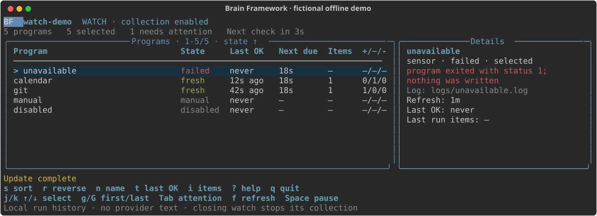

# Watch and schedule updates

Run reviewed sensors, routines and [assistants](prompts.md) automatically from one brain:

| Goal                                | Command                                                         |
| ----------------------------------- | --------------------------------------------------------------- |
| Preview or run one update cycle     | `bf update --dry-run`, then `bf update` and `bf status --check` |
| Run continuously in a terminal      | `bf watch`                                                      |
| Observe another collector read-only | `bf status --watch` (runs nothing)                              |
| Run unattended in the background    | `bf watch --json` as a [user service](#run-watch-as-a-service)  |

Set `enabled: false` to disable a program, or keep `refresh: 0` (and no `at` or `schedules`) for manual-only programs. Keep CI strictly offline (`bf validate`, `bf eval`).

## Watch collection

```bash
bf watch
```

`bf watch` runs due sensors and routines immediately and rechecks every `interval` seconds (default 60), while continuously dispatching assistant streams, batch reads, schedules, wakes and channel deliveries (`@` marks assistants). Stopping watch terminates all owned process groups cleanly.

[](../assets/watch.svg)

| Key                   | Effect                                                                                   |
| --------------------- | ---------------------------------------------------------------------------------------- |
| `j` / `k`, arrows     | Select a program and inspect its details, log tail and latest action.                    |
| `g` / `G`, Home / End | Jump to first or last program.                                                           |
| Tab                   | Filter to programs needing attention (failed, due, never succeeded once due, degraded).  |
| `f` (or `u`)          | Reload `bf.yaml` and check due work now (new assistants still require restarting watch). |
| Space                 | Pause or resume future checks (`bf watch` only).                                         |
| `?` / `q`             | Toggle key guide / cancel active update and quit (Ctrl-C exits 130).                     |

### Sort the dashboard

Press `s` to cycle sort fields, `n` / `t` / `i` to sort by name, last success or returned item count, and `r` to reverse (`bf watch` and `bf status --watch`, minimum 80×24 color terminal, `NO_COLOR` respected).

For service supervision, `bf watch --json` streams JSON Lines snapshots every `poll_interval` seconds (`brain`, `running`, `assisting`, `message`, `programs` — see [`Row`](https://github.com/fmind/brain-framework/blob/main/src/bf/watch.py)) and writes `bf:` diagnostics to stderr. Only one active collector (`bf watch --json` or primary `bf watch`) may own a brain; a second interactive `bf watch` falls back to observation mode, and concurrent `bf update` runs serialize up to 10 minutes (`another update is still active`).

## Watch preferences

Override defaults on the CLI (`bf watch --interval 300 --notify off`) or persist them in `bf.yaml`:

```yaml
# https://fmind.github.io/brain-framework/docs/schedule/#watch-preferences
watch:
  interval: 300
  notifications: off
```

| Setting                 | Default   | Accepted values                                                                                                        |
| ----------------------- | --------- | ---------------------------------------------------------------------------------------------------------------------- |
| `interval`              | `60`      | Seconds between checks for due work (`5`–`86400`).                                                                     |
| `poll_interval`         | `2`       | Seconds between history reads and JSON snapshots (`0.2`–`60`).                                                         |
| `notifications`         | `failure` | `off`, `failure`, `success` or `all` (`osascript`/`notify-send`/`gdbus`, never quoting source names or provider text). |
| `notification_cooldown` | `300`     | Minimum seconds between desktop alerts (`0`–`86400`).                                                                  |

## Select programs

Filter `bf update` or `bf watch` with repeatable `--sensor`, `--routine`, `--assistant` (and `--kind sensor|routine|assistant` on `bf update`):

```bash
bf update --sensor git-commits --dry-run
bf watch --sensor git-commits --routine weekly-review
```

Unknown names fail up front; selectors never force disabled or manual programs to run.

## Run watch as a service

Run `bf watch --json` under your OS service manager so collection and assistant streams stay up without an open terminal. Set explicit `PATH` (including `bf` and provider CLIs), forward custom `XDG_CONFIG_HOME` / `XDG_STATE_HOME` if used, keep [credentials](sensors.md#credentials) in CLI logins or mode-`600` files, and keep service files out of shared Git history.

On Linux, save `~/.config/systemd/user/bf-watch.service`:

```ini
# https://www.freedesktop.org/software/systemd/man/latest/systemd.service.html
[Unit]
Description=Brain Framework watch

[Service]
Environment=PATH=%h/.local/bin:/usr/local/bin:/usr/bin:/bin
ExecStart=%h/.local/bin/bf watch --json --brain %h/brain
StandardOutput=null
Restart=on-failure
RestartSec=60
SuccessExitStatus=130

[Install]
WantedBy=default.target
```

```bash
systemd-analyze --user verify ~/.config/systemd/user/bf-watch.service
systemctl --user daemon-reload
systemctl --user enable --now bf-watch.service
journalctl --user -u bf-watch.service -n 30 --no-pager
```

On macOS, save `~/Library/LaunchAgents/bf-watch.plist` (replacing `/Users/me` with your literal home path):

```xml
<?xml version="1.0" encoding="UTF-8"?>
<!DOCTYPE plist PUBLIC "-//Apple//DTD PLIST 1.0//EN" "http://www.apple.com/DTDs/PropertyList-1.0.dtd">
<plist version="1.0">
<dict>
  <key>Label</key>
  <string>bf-watch</string>
  <key>ProgramArguments</key>
  <array>
    <string>/Users/me/.local/bin/bf</string>
    <string>watch</string>
    <string>--json</string>
    <string>--brain</string>
    <string>/Users/me/brain</string>
  </array>
  <key>EnvironmentVariables</key>
  <dict>
    <key>PATH</key>
    <string>/Users/me/.local/bin:/opt/homebrew/bin:/usr/local/bin:/usr/bin:/bin</string>
  </dict>
  <key>RunAtLoad</key>
  <true/>
  <key>KeepAlive</key>
  <dict>
    <key>SuccessfulExit</key>
    <false/>
  </dict>
  <key>ThrottleInterval</key>
  <integer>60</integer>
  <key>ExitTimeOut</key>
  <integer>60</integer>
  <key>StandardOutPath</key>
  <string>/dev/null</string>
  <key>StandardErrorPath</key>
  <string>/Users/me/Library/Logs/bf-watch.log</string>
</dict>
</plist>
```

```bash
plutil -lint ~/Library/LaunchAgents/bf-watch.plist
launchctl bootstrap "gui/$(id -u)" ~/Library/LaunchAgents/bf-watch.plist
launchctl print "gui/$(id -u)/bf-watch"
```

Alternatively, run `bf update --brain BRAIN` from a systemd timer, `StartCalendarInterval` or cron when you need no persistent channel streams. See [systemd lingering](https://www.freedesktop.org/software/systemd/man/latest/loginctl.html), [WSL systemd](https://learn.microsoft.com/en-us/windows/wsl/systemd), [ChromeOS lifecycles](https://www.chromium.org/chromium-os/developer-library/guides/containers/containers-and-vms/#lifecycles) and [Apple LaunchAgents](https://developer.apple.com/library/archive/documentation/MacOSX/Conceptual/BPSystemStartup/Chapters/CreatingLaunchdJobs.html).

## Timing and health

- **Cadence**: sensors use `refresh` seconds; routines use either `refresh` seconds or wall-clock `at: "HH:MM"` (`days`, `timezone`), never both; assistant `schedules` set either `every` seconds or `at: "HH:MM"` (`days`, `timezone`), never both. Keep watch `interval` shorter than your smallest `refresh` / `every`.
- **Declarative gates (`when:`)**: routines and assistant schedules with `when:` evaluate SQLite/health offline and skip unmatched checks as `gated` without spawning a process.
- **Retries and self-healing**: failed sensors and routines back off 1, 2, 4, 8… minutes up to `refresh`. Assistant jobs follow `retries` and `idempotent` (including exit `75` tempfail retries); `uncertain` jobs hold their schedule for manual `bf queue` inspection, while terminal `failed` scheduled jobs are superseded at the next due slot so periodic schedules self-heal after transient outages.

Freshness states in `bf status` (local to the collecting machine):

| State     | Meaning                                                                                       |
| --------- | --------------------------------------------------------------------------------------------- |
| `fresh`   | Succeeded within `2 × refresh`/`every` (or within 86,400s of the latest due `at` slot).       |
| `overdue` | Scheduled and previously succeeded, but past its `2 × refresh`/`every` or 86,400s `at` grace. |
| `never`   | Scheduled with no local current success (joins `attention` once due).                         |
| `manual`  | `refresh: 0` and no `at` or `schedules`.                                                      |
| `unknown` | Disabled program or historical source.                                                        |

`bf status --check` exits 1 whenever [`attention`](commands.md#attention-entries) is non-empty. Every `attention` entry across `bf status`, Home and `bf read review` carries uniform `{"kind": "sensor"|"routine"|"assistant"|"channel", "name": "...", "freshness": "..."}` fields (plus optional `"failed": true`, `"silent": true` and `"degraded"`).

### Silent sources

Detect broken filters or expired feeds that keep returning 0 changes by setting `silent_after` (seconds above the source's longest quiet spell, such as a weekend):

```yaml
# https://fmind.github.io/brain-framework/docs/sensors/
sensors:
  mail:
    command: [sensors/gmail-headers.py, "{{start}}", "{{end}}"]
    refresh: 3600
    silent_after: 172800
```

When an enabled scheduled source has stored records and its newest `changed` timestamp is older than `silent_after`, it marks `"silent": true` in `bf status`, `memories` pages and search [coverage](retrieval.md#source-coverage), joins `attention` and fails `bf status --check` until a new or updated record arrives.
