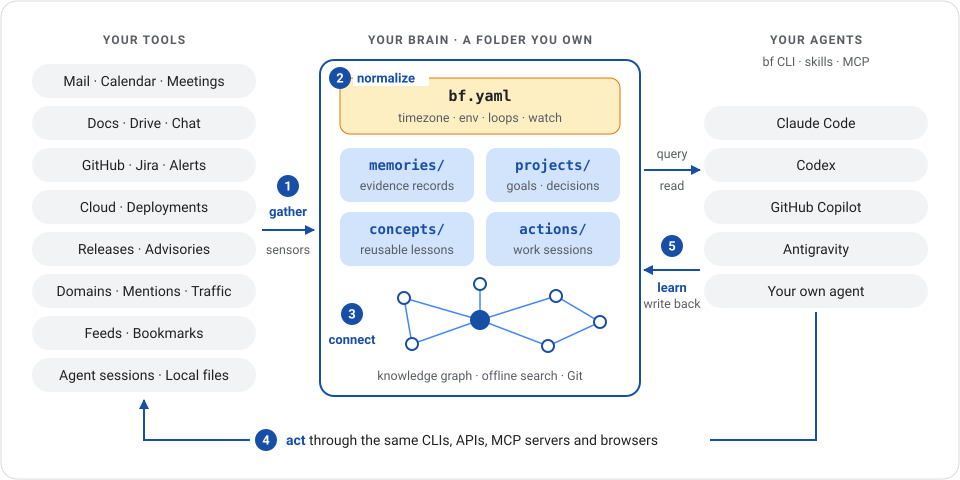

# Overview

**Brain Framework (`bf`)** turns a plain Git folder of Markdown notes, schema-validated JSONL records, and shell or Python loops into a fast, offline knowledge brain for humans and AI coding agents. Start in 2 minutes with [Getting started](getting-started.md).

It stays intentionally simple: three formats (**YAML for config**, **Markdown for humans**, **JSONL for records**), a clean **3x3 layout**, a disposable SQLite FTS5 cache, three minimal runtime dependencies, and zero built-in LLMs. Flat JSONL stays canonical on disk so `bf query`, `rg`, `jq`, and DuckDB all work side by side.



## The 3x3 layout

```text
my-brain/
├── bf.yaml         # Declarative config (notes, brains, search, concurrency, loops)
├── concepts/       # Durable knowledge (<slug>.md or <slug>/index.md bundles)
├── projects/       # Ongoing initiatives and decisions
├── actions/        # Scoped requests, deliverables, and attachments
├── sensors/        # Deterministic collectors (stdout JSONL -> memories/)
├── routines/       # Maintenance scripts and continuous daemons (when: daemon)
├── agents/         # Coding-harness or LLM tasks
├── schemas/        # Optional domain JSON Schemas (core record schema always enforced)
├── evals/          # User-owned Python/pytest contract checks
├── memories/       # Canonical JSONL (_notes.jsonl + <source>.jsonl; gitignored)
├── logs/           # Private 0700 structured JSONL loop logs (gitignored)
└── .bf/            # Private 0700 runtime: disposable cache/index.sqlite3, state/, locks/
```

## Architecture

1. **Notes (`concepts/`, `projects/`, `actions/`)**: YAML 1.2 frontmatter plus CommonMark Markdown, supporting flat `<slug>.md` files and `<slug>/index.md` folder bundles. Add `#id` heading anchors, checklist tasks, and typed links (`[Ticket](jira:WEB-1){rel=cites}`).
2. **Loops (`sensors/`, `routines/`, `agents/`)**: Plain shell, Python, or executable scripts declared in `bf.yaml`. Loops read `BF_*` env, per-loop `env_from:` secrets, and matched JSONL events on `stdin`; emit data or events on `stdout`; and log structured JSONL on `stderr`.
3. **Records (`memories/_notes.jsonl`, `memories/<source>.jsonl`, `logs/<loop>.jsonl`)**: Always validated against bundled `bf` and `record` schemas, with optional `schemas/<source>.json` files for stricter domain checks. Read-only retrieval commands never mutate disk.

## How `bf` compares

| Approach                        | Storage & ownership                           | Agent interface & retrieval                                 | Automation & trust boundary                                      |
| ------------------------------- | --------------------------------------------- | ----------------------------------------------------------- | ---------------------------------------------------------------- |
| **Brain Framework (`bf`)**      | Plain Git Markdown + canonical JSONL          | Read-only CLI, offset-indexed BM25 FTS5, `rg`/`jq`/DuckDB   | Explicit `loops:` with per-loop `env_from:`, pools, `bf watch`   |
| **Plain Markdown / Obsidian**   | Local Markdown files (human-first)            | Filename/grep search; no record schemas or staleness review | Manual upkeep or UI plugins; no structured sensor ingestion      |
| **Hosted / MCP memory servers** | Opaque or remote DB with auto-extracted facts | Always-on MCP tool schemas + model-mediated recall          | Extra service/API keys; inferred facts harder to audit in Git    |
| **Generic vector RAG**          | Chunked embeddings in a vector index          | Semantic similarity over opaque chunks                      | Requires embedding models/pipelines; weak provenance & backlinks |

## Start small, automate when ready

Adopt `bf` in two tiers without changing your folder layout:

| Tier              | Goal                                                                   | Commands                                                                |
| ----------------- | ---------------------------------------------------------------------- | ----------------------------------------------------------------------- |
| **1. Core**       | Author Markdown notes, validate links, and search offline              | `init`, `build`, `query`, `read`, `review`, `check`, `status`, `schema` |
| **2. Automation** | Ingest tool feeds, trigger loops or agents, and supervise continuously | `ingest`, `run`, `watch`, `emit`, `events`, `pause`, `resume`, `state`  |

## Guides

| Guide                                 | What you will learn                                                                                           |
| ------------------------------------- | ------------------------------------------------------------------------------------------------------------- |
| [Getting started](getting-started.md) | Create a brain, ingest records, write a linked decision, compile with `bf build`, and search with `bf query`. |
| [Authoring](authoring.md)             | Structure flat notes and `index.md` bundles, heading `#id` anchors, universal refs, and optional schemas.     |
| [Retrieval](retrieval.md)             | Orient with `bf status` and `bf review`, read sections with `bf read`, and search with `bf query` or DuckDB.  |
| [Operations](operations.md)           | Configure explicit `loops:`, `env_from:` allowlists, pools, `debounce:`, `bf watch`, and security limits.     |
| [Reference](reference.md)             | Look up every CLI command, exit code, `BF_*` variable, `bf.yaml` config, and bundled JSON Schema.             |
