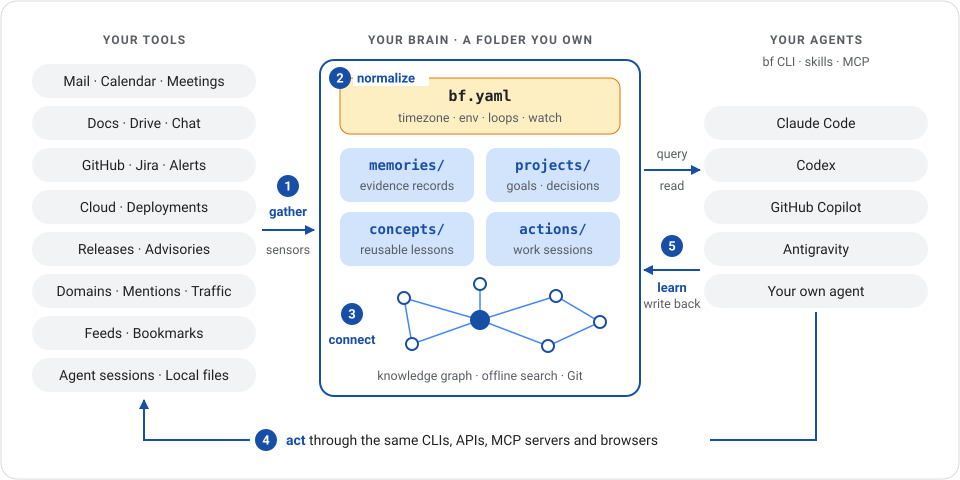

# Overview

Brain Framework (`bf`) keeps a local-first knowledge brain built around three rules: **YAML for config**, **JSON for records**, and **Markdown for humans**. `bf` compiles Markdown notes and sensor payloads into individual Draft 2020-12 schema-validated JSON files (`memories/**/*.json`) that humans and AI agents query offline with `rg` and `jq` (`bf query`, `bf read`, or `bf mcp`).

## Three-format architecture

1. **YAML for config.** Configure timezone, environment, unified `loops:`, and `watch` settings in `bf.yaml` (`version: 15`, humanized durations like `15m` or `1d`, cron expressions, single or multi-schedule lists, optional gitignored `.env`), deterministic checks in `evals/*.yaml`, and note frontmatter in YAML 1.2.
2. **Markdown for humans.** Track volatile TODOs in `projects/`, durable knowledge in `concepts/`, dated workspaces in `actions/YYYY-MM-DD_topic/ACTION.md`, and input prompts in `prompts/`. Attach structured metadata directly to headings (`## MCP {#mcp license=mit}`), links (`[AAIF](../concepts/aaif.md#mcp){rel=depends-on}`, `[Ticket](jira:WEB-1)`, or `bf:///concepts/aaif.md`), tasks, and blocks (`{: #decision-1 confidence=high}`) using Python-Markdown's `attr_list` extension.
3. **JSON for records.** `bf build` compiles Markdown notes into `memories/{concepts,projects,actions}/<slug>.json` and maintains `.bf/index.jsonl`; `bf ingest SOURCE` writes sensor records into `memories/<source>/<sha256(id)>.json` — validated by package-owned core schemas and user `schemas/*.json` — while runtime orchestration keeps state in `.bf/` and writes plain JSON lines to `logs/<name>.log` and `logs/events.log`.

## Guides

- [Getting started](getting-started.md): create a brain, ingest evidence, author a project note with `attr_list` metadata, and query `memories/` with `bf query`, `bf read`, and `bf check`.
- [Authoring](authoring.md): write OKF Markdown with Python-Markdown extensions (`attr_list`, `footnotes`, `tables`, `def_list`, `admonition`), relative / `source:id` / `bf://` links, `bf new`, and `schemas/*.json`.
- [Retrieval](retrieval.md): orient with `bf status` and `bf review`, read selectively (`--outline`, `--lines`, `--fields`, `--max-bytes`), query via `rg` and `jq` (`--format jsonl|tsv`), and run `bf mcp` or `bf eval`.
- [Operations](operations.md): orchestrate unified `loops:` (sensors, routines, git hooks, continuous `daemon: true` listeners, and autonomous thinking bots), emit events (`emit:` / `bf emit`), supervise concurrently with `bf watch`, and preserve security boundaries.
- [Reference](reference.md): exact CLI flags, exit codes, flat folder layout, `bf.yaml` (`version: 15`), and published JSON Schemas (`bf schema`).
